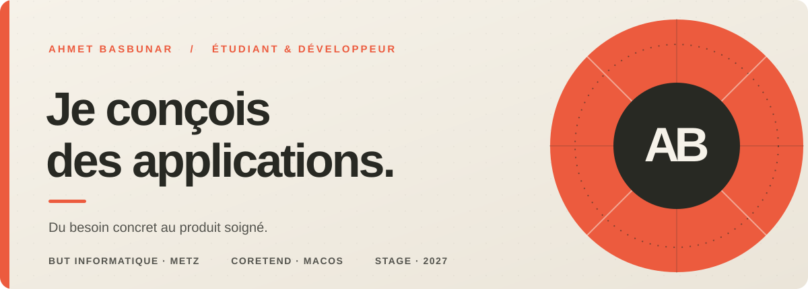

 

[Portfolio](https://ahmetbsbnr.com) · [LinkedIn](https://www.linkedin.com/in/ahmet-basbunar/) · [Me contacter](mailto:contact@ahmetbsbnr.com)

## Salut, moi c’est Ahmet 👋

Étudiant en **BUT Informatique à Metz**, j’aime concevoir des applications utiles, de la réflexion sur les données jusqu’à l’interface. Je développe surtout en **Swift**, **TypeScript** et **C**.

## Projet phare

<table>
<tr>
<td width="45%" valign="middle">
<a href="https://github.com/ahmetbsbnr/coretend">
<picture>
  <source media="(prefers-color-scheme: dark)" srcset="https://raw.githubusercontent.com/ahmetbsbnr/coretend/main/Website/screenshots/home-fr-dark.png">
  
</picture>
</a>
</td>
<td valign="middle">

### [CoreTend ↗](https://github.com/ahmetbsbnr/coretend)

Une application macOS native et open source pour analyser et nettoyer son espace disque.

`Swift 6` · `SwiftUI` · `SQLite`

**207 tests** · Annulation des nettoyages · Sans télémétrie

[Site du projet](https://coretend.ahmetbsbnr.com) · [Télécharger](https://github.com/ahmetbsbnr/coretend/releases)

</td>
</tr>
</table>

## Quelques projets

- [S.A.T.](https://github.com/ahmetbsbnr/sat-securite-avant-tout) — gestion d’activité pour une entreprise de sécurité · TypeScript, Deno, MySQL
- [Club ThemActu](https://github.com/ahmetbsbnr/club-themactu) — gestion des adhérents et abonnements · TypeScript, PHP, MySQL
- [Jeux en C](https://github.com/ahmetbsbnr/jeu-de-nim) — Nim, Memoryx et autres jeux de stratégie

## En bref

**Outils**　Swift · SwiftUI · TypeScript · C · Python · PHP · SQL

**Je recherche**　Un stage de **2 mois minimum à partir du 12 avril 2027**, à Metz et alentours ou au Luxembourg.

[Écris-moi ↗](mailto:contact@ahmetbsbnr.com) · [Mon portfolio](https://ahmetbsbnr.com)

